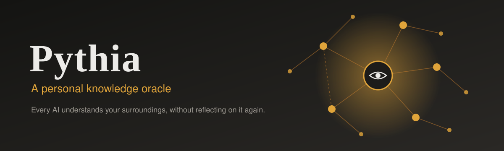
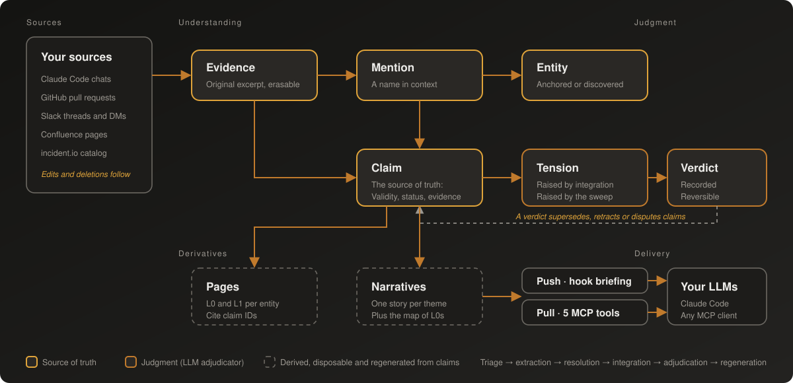

<p align="center">
  
</p>

<p align="center">
  <a href="https://github.com/caribeedu/pythia/actions/workflows/tests.yml"></a>
  
  
  <a href="LICENSE"></a>
</p>

# Pythia

Pythia continuously reads the places where your work happens, keeps a base of atomic claims with provenance and time, detects when knowledge becomes outdated or contradictory, and delivers what matters to your LLMs, automatically through hooks (push) and on demand through MCP (pull).

It is the spiritual successor of [Twin](https://github.com/caribeedu/twin) and the goal is the same.

> [!IMPORTANT]
> **Need a knowledge oracle, or just an AI that truly sees you?** Pythia is for those who need to cross-reference complex contexts, and it spends a lot of tokens to do it.
> **[who-am-ai](https://github.com/caribeedu/who-am-ai)**, a leaner alternative, listens to what you say to your assistant, and how, and keeps one short profile it loads every time.
> It keeps only general, durable preferences, never one-off task details, in a file you can read, edit and veto. A fraction of the tokens. To stop repeating yourself, start there.

## Why

AI assistants forget. Each session starts blank, so you keep explaining how you write, who owns which system, what the team decided last week and what caused that bug. Product memories help inside one assistant; retrieval returns fragments without knowing which are still true. Pythia keeps *what is currently true*, where it came from, and what changed.

## Features

- **Claims, not documents.** The source of truth is the atomic claim (subject, attribute, value, validity, status, evidence). Pages and narratives are derivatives that cite claims, go stale only when a cited claim changes, and can be regenerated at any time.
- **Open-world entity resolution.** People, teams, systems and projects are resolved from context by an LLM, seeded by registries such as the incident.io catalog. Merge, split and relink are reversible events.
- **Conflict and drift handling.** New claims are confronted with what is already known. An adjudicator agent investigates, with live access to the sources (current file, CODEOWNERS, Slack thread, Confluence page), and records a reversible **verdict**: temporal supersession, real conflict, different scope, outdated source, duplicate. A periodic sweep looks for drift with no trigger.
- **You are the authority.** There are no approval queues. The system writes its result and you correct it afterwards; your corrections always win and become quality metrics and test examples.
- **Edits and deletions are respected.** An edit retracts the previous version; a deletion at the source erases the content *and* every derived text, including old page versions.
- **Small external interface.** Five MCP tools (`search`, `open`, `timeline`, `correct`, `define`) and a short push briefing whose text is always stored knowledge, never generated prose.
- **No LLM, no guessing.** Judgment is always done by an LLM; there are no regex or heuristic fallbacks. Without a key, network or budget, ingestion continues and reads serve what was already concluded, with a notice.
- **Measured.** Cost ledger and monthly cap, golden questions with a sealed half and a plain-search baseline, correction rate per role, and a method to measure avoided re-explanation ([docs/measuring-value.md](docs/measuring-value.md)).

### Sources and consumers

| Sources | Consumers |
|---|---|
| Claude Code sessions (per chat, explicit allowlist) | Claude Code: hook push (`SessionStart`, `UserPromptSubmit`) |
| GitHub pull requests (diffs, reviews, comments) | Claude Code and any MCP client: pull |
| Slack channels, threads and DMs (user token, no bot) | |
| Confluence spaces and page trees, with comments | |
| incident.io catalog (entity seed) | |

Zoom is planned.

### The web interface

| Screen | What it shows |
|---|---|
| **Evolution** | What changed and why, newest first: one line per cause, with before/after of the claims, page diffs and per-attribute trajectories |
| **Explore** | Ego graph around any entity with a time slider; correct, relink, merge or retract from the side panel |
| **Sources** | The allowlist, connector state, backfill estimates and what is being processed right now |
| **Usage** | Exactly what was pushed to each chat and what each MCP call returned |
| **Costs** | Spend against the cap, by role, source and model |
| **Quality** | Correction rate, golden questions and baseline, detector precision, value metrics |
| **Config** | Models per role, budget, credentials (kept in the OS keychain), Claude Code integration |

## How it works

<p align="center">
  
</p>

A unit of a source (a settled thread, a merged PR, a chat delta, a page edit) goes through **triage → extraction → entity resolution → integration → adjudication (when needed) → regeneration of derivatives**, on a single Postgres job queue with separate lanes for I/O, cognition and derivation. State is event-sourced, so the base can answer both *what is true* and *what Pythia believed at time T*.

Details: [docs/architecture.md](docs/architecture.md).

## Getting started

**Requirements:** Python 3.13 or 3.14, [uv](https://docs.astral.sh/uv/), Docker (Postgres 17 with pgvector) and an [Anthropic API key](https://console.anthropic.com/). Credentials are stored with the OS keychain (`keyring`); autostart at login is available on macOS.

```bash
uv sync
```

```bash
.venv/bin/pythia start
```

`start` brings up the database container if needed, then runs the daemon and the web server in the background. Open <http://127.0.0.1:7117> and:

1. **Config:** add your Anthropic API key, review the models per role and set the monthly cap.
2. **Sources:** turn on the Claude Code chats to read, and add repositories, Slack conversations or Confluence spaces. Each new source enters paused with a cost estimate for its backfill.
3. **Config → Claude Code integration:** copy the MCP command (pull) and the hooks snippet (push) into your Claude Code setup.

### Command line

The CLI only manages the process; everything else is configured on the web.

| Command | Does |
|---|---|
| `pythia start` / `stop` / `status` | Start, stop or inspect the background process |
| `pythia run` | Run in the foreground |
| `pythia autostart` | Start at login (macOS LaunchAgent); `--off` undoes it |

Environment: `PYTHIA_HOME` (default `~/.pythia`: pid file and logs) and `PYTHIA_DATABASE_URL` (use your own Postgres instead of the container; it needs the `vector` extension).

## Development

Tests run against a real Postgres, a fake LLM and a fake embedder, so they are fast and cost nothing.

```bash
docker compose up -d
```

```bash
docker exec pythia-db psql -U pythia -c "create database pythia_test"
```

```bash
.venv/bin/python -m pytest -q
```

If you change a prompt or schema, bump `VERSION` in `src/pythia/pipeline/prompts.py`; the golden questions then run on their own.

### Repository layout

| Path | What |
|---|---|
| `src/pythia/events.py` | Append-only event log, projections and `rebuild` |
| `src/pythia/knowledge.py` | Knowledge commands: claims, mentions, verdicts, cascade, tombstones |
| `src/pythia/connectors/` | Claude Code, GitHub, Slack, Confluence and incident.io |
| `src/pythia/pipeline/` | Triage, extraction, resolution, integration, adjudication, sweep, derivation, corrections |
| `src/pythia/llm/client.py` | Roles, structured output, agent loop, cost ledger, cap and halt |
| `src/pythia/consumer.py`, `mcp_server.py` | The five MCP tools and the push briefing |
| `src/pythia/web/` | FastAPI app, templates and the Explore graph |
| `src/pythia/daemon.py`, `jobs.py` | Job queue, lanes and scheduler |
| `src/pythia/migrations/` | Postgres schema |

## Documentation

| Document | About |
|---|---|
| [Architecture](docs/architecture.md) | Knowledge model, entity resolution, conflicts, ingestion, consumption, stack |
| [Decisions](docs/decisions.md) | Numbered core decisions (D1–D22) and how each area applies them |
| [Design rationale](docs/design-rationale.md) | Why it is the way it is: principles, influences and what real use taught |
| [Measuring value](docs/measuring-value.md) | Metrics, experiment design and results |
| [Known limitations](docs/known-issues.md) | Open problems and their proposed fixes |

## Principles

1. Judgment is always an LLM; determinism is for plumbing only.
2. No LLM, no function, and no fallback that pretends otherwise.
3. A truth that is wrong but correctable beats a hypothesis waiting for approval.
4. Rich agents inside, a lean interface outside.
5. Derivatives are disposable; evidence, entities, claims, verdicts and human decisions are the only state that matters.

## Contributing and security

See [CONTRIBUTING.md](CONTRIBUTING.md) before opening a pull request, and [SECURITY.md](SECURITY.md) to report a vulnerability.

## License

[MIT](LICENSE)
